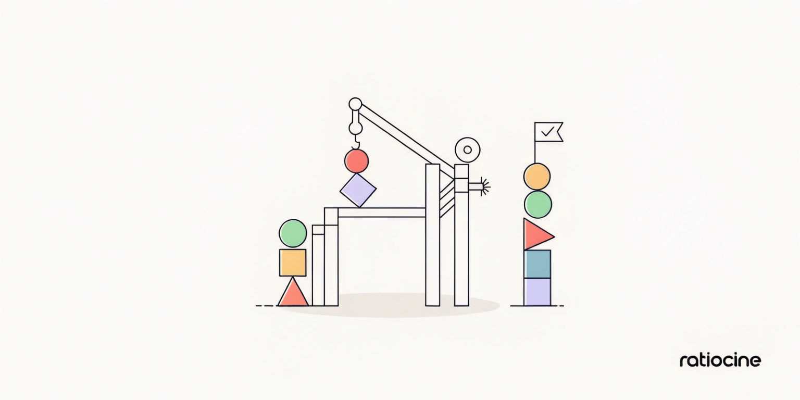

# ratiocine

**Logical reasoning from linguistic fragments. Rat-i-o-cine: the process of reasoning.**



**Latest: rank 1 and rank 2 on the [Delta League](https://deltaleague.ai) qwen35-08b-v1 weight-editing leaderboard** — zero training, ~$25 of compute. Writeup: [Rank 1 on a model-editing leaderboard with $25 and zero training](https://dev.to/papajams/rank-1-on-a-model-editing-leaderboard-with-25-and-zero-training-4el2). The delta-graph we mined from the board (per-tensor recipe forensics on 11 checkpoints) is open at [`data/delta/delta-graph.json`](data/delta/delta-graph.json); the full method is in [`docs/model-competitions.md`](docs/model-competitions.md).

An AI that solves International Linguistics Olympiad (IOL) problems — deducing
grammar, vocabulary, and structure from a handful of examples in unfamiliar
languages. It ships three things:

1. **A competition solver and playable showcase** — IOL-AI 2026 entry
   (Qwen2.5-14B, **2nd of 48 teams** on the private split) plus a daily linguistics deduction
   game — 10 rotating puzzles with an AI-vs-human verdict — at
   [`ratiocine.vercel.app`](https://ratiocine.vercel.app).
2. **Ration, a verifiable evaluation logbook** — a Neutron app that, when
   installed in a user's canister, deterministically grades submitted AI
   outputs, chain-key-signs evaluation assertions, and can publish a certified
   report. Its Week 1 Neutron Hackathon package (`ratiocine_l.neutron`, v1,
   approximately 272 KB) has been submitted; the public Ration landing and
   unsigned solve preview are at
   [`ratiocine.trustfall.xyz`](https://ratiocine.trustfall.xyz).
3. **Weight-space model research** — delta forensics, model soups, and edit
   composition on small open models (Qwen3.5-0.8B), with reproducible local
   eval runners in [`scripts/delta/`](scripts/delta/).

The submission, the live browser-to-Modal preview, and the local PocketIC
attestation demo are verified separately. The Ration canister is live on ICP
mainnet (`cvrwv-mqaaa-aaaai-ax4pa-cai`) with certified ledger reports, and the
showcase attestation relay signs entries end-to-end; a standalone
certificate-aware verifier is still on the roadmap.

## Quick links

- **Architecture, deployment evidence & trust boundaries** → [`docs/architecture.md`](docs/architecture.md)
- **Model competitions** (Delta League forensics, results, recipes) → [`docs/model-competitions.md`](docs/model-competitions.md)
- **IOL-AI competition** (pipeline, results, lessons) → [`docs/iolai-competition.md`](docs/iolai-competition.md)
- **Neutron / Ration hackathon submission and plan** → [`docs/neutron-plan.md`](docs/neutron-plan.md)

## Layout

```
├── hf-pipeline/      # HF production pipeline (train + submit script.py)
├── src/arkor/         # Arkor rapid prototyping (TypeScript)
├── ration-app/        # Neutron app source (Motoko backend + React tile)  ← canonical
├── neutron/           # local clone of infu/neutron (gitignored) — for building
├── showcase/          # Next.js scroll journey + daily game + /explore stations (Vercel)
├── data/synthetic/    # IOL training data
├── netlify/functions/ # /api/solve + /api/status proxy → Modal (trustfall.xyz front)
└── docs/              # this readme's detail lives here
```

## Quick start

```bash
# Showcase (Vercel): scroll journey, daily game, /explore station journey
cd showcase && npm install && npm run dev   # → http://localhost:3000

# Neutron app: sync → build → local PocketIC
./scripts/sync-ration-app.sh
cd neutron && npm --workspace neutron-ratiocine run package
```

## Virality (Nikita Bier playbook)
Daily game + share grid is the Wordle shape: activation = first puzzle value in 3 seconds. Run the K-factor worksheet on shares → new players, then a 48-hour test on the share copy.
