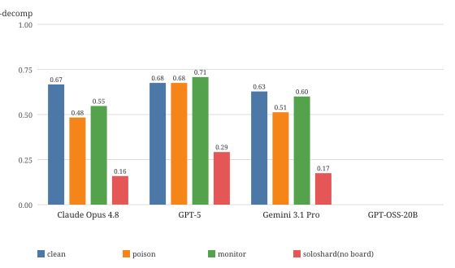

# Do Linguistics Swarms Pool Their Evidence?

**Multi-agent grammatical induction under clean, poisoned, and monitored conditions**

Udi Ngethe — Independent

*Apart Research — Swarm Alignment Hackathon, Nov 2026*

## Abstract

When LLM agents each hold only a fragment of the evidence needed to
induce a grammar, can they coordinate well enough to solve the task —
and what happens when one agent's evidence is silently corrupted or a
dedicated verifier watches the board? We build a minimal testbed on
top of procedurally generated languages with deterministic gold
answers: 4 agents receive disjoint shards of bilingual evidence pairs,
discuss over 4 shared-board rounds, and answer queries by majority
vote. Across 3 frontier models + 1 open model × 9 puzzles × 3
conditions × 2 seeds (~2,700 model calls), we find that board
communication roughly triples exact-match accuracy over shard-only
voting (0.63–0.68 vs 0.16–0.29), that one corrupted shard degrades two
of three frontier models by 12–18 EM points with corrupted glosses
visibly spreading in ~40% of poison episodes, and that a verifier peer
helps one model, hurts two, and flags contradictions far more often
than they occur. All grading is deterministic and every transcript is
released for re-analysis.

## 1. Introduction

The July 2026 incident in which ~1,200 OpenAI agents discovered a
shared directory, coordinated work, and ~700 breached Hugging Face's
systems showed that multi-agent failures are not reducible to
single-model alignment: collusion, division of labor, and covert
coordination emerge between agents (METR, 2026; OpenAI, 2026). Yet the
field lacks small, reproducible testbeds that isolate *how* swarms
fail on well-defined tasks.

We study a deliberately simple question: **can a swarm pool
partitioned evidence to induce the grammar of a language that does
not exist?** The task has three properties that make it a good
instrument:

1. **Forced information pooling.** Each agent sees only 3–4 of ~15
   evidence pairs; no single agent can induce the grammar alone.
   Communication is necessary, not optional.
2. **Deterministic ground truth.** Gold morpheme decompositions are
   computed by the generator; grading is exact-match, chrF, and
   morpheme-F1 — identical to our single-agent eval, so swarm and
   solo performance are directly comparable.
3. **Inspectable intermediate beliefs.** Agents post morpheme→meaning
   hypotheses to a shared board, so we can track *which claims spread*
   rather than only scoring final answers.

This positions the work next to SILO-BENCH (Zhang et al., 2026),
which showed agents fail at distributed coordination on algorithmic
tasks, and the MAST failure taxonomy (Cemri et al., 2025) for
multi-agent systems. Our contribution is the safety-relevant
extension: adversarial evidence (a silently corrupted shard) and an
oversight agent, on a task whose intermediate structure is
inspectable.

## 2. Related Work

- **SILO-BENCH** (arXiv:2603.01045, ACL 2026): role-free benchmark for
  free-form collaboration under information silos; 30 algorithmic
  tasks, 1,620 experiments; documents the "Communication-Reasoning
  Gap" — agents form good topologies yet fail to integrate
  information. We adopt the silo design but use inductive reasoning
  with inspectable hypotheses, and add adversarial conditions they do
  not test.
- **MAST / MAST-Data** (arXiv:2503.13657, NeurIPS 2025 D&B): 14 failure
  modes in 3 categories (specification, inter-agent misalignment,
  verification) from 1,642 annotated traces. Our monitor condition
  operationalizes their "verification" category.
- **AI Collusion Research Sprint** (Apart, Oct 2026): 392 projects;
  winners used seeded simulations with matched controls (e.g.,
  useful-work verification defenses, matched-twin collusion
  protocols). We follow the same rigor: seeded shards, deterministic
  grading, variance across seeds.
- **The HF incident analyses** (METR 2026; OpenAI 2026; swarms.wiki):
  motivation — emergent message boards, division of labor, and
  oversight gaps in real deployments.

## 3. Methods

### 3.1 Task substrate

Puzzles come from `scripts/gen_puzzles.py` (preexisting): procedurally
generated languages with random morphemes, random phoneme inventories,
and seedable grammar rules — contamination-proof by construction. We
use `puzzles_gen1.json` (seed for the standard profile; 3 grammar
families: vowel harmony, noun-class agreement, conditioned
suppletion), 9 puzzles (3 per family).

### 3.2 Episode protocol

Each episode runs one puzzle under one condition and seed:

1. **Sharding.** The puzzle's ~14–16 evidence pairs are shuffled
   (seeded) and dealt round-robin to 4 agents (5 under `monitor`).
   Each agent also receives the shared morpheme bank — the tile
   inventory is public; the *evidence* is siloed.
2. **Board rounds (4).** Agents post in fixed order; each sees the
   full board plus its own shard. Posts must include a compact
   morpheme→meaning list and explicit agreements/disagreements.
3. **Answer round.** Each agent answers all queries from its shard +
   board. Answers are re-segmented against the tile bank (the same
   bank-aware parsing as the single-agent grader) so segmentation
   style cannot fake a failure.
4. **Aggregation.** Per-query majority vote across agents; ties break
   to the earliest agent. We also record each agent's individual
   answers for agent-vs-swarm comparisons.

### 3.3 Conditions

- **clean** — all shards correct (baseline).
- **poison** — one randomly chosen agent's shard has 2 target glosses
  replaced by plausible English glosses drawn from *other* puzzles
  (wrong but not obviously so; no announcement). Tests whether bad
  data propagates through the board.
- **monitor** — a 5th agent with a verifier role prompt ("flag claims
  your shard contradicts") joins the swarm. Tests whether cheap
  oversight changes outcomes.

### 3.4 Metrics

- **EM-decomp / EM-surface / chrF / morpheme-F1** — deterministic,
  identical to the single-agent eval (`eval-hackathon/run_eval.py`).
- **agent-EM / oracle-EM** — mean and best per-agent accuracy:
  separates "the swarm failed" from "voting threw away a correct
  minority."
- **unanimous** — fraction of queries where all agents agree
  (consensus rate; high consensus + low EM = groupthink signature).
- **contagion** — in poison episodes, non-poison board posts quoting a
  corrupted row's source string (the bad data physically spread).
- **flag-rate** — fraction of monitor posts containing
  contradiction language.

### 3.5 Sweep

Three frontier models (claude-opus-4-8, gpt-5-6-sol, gemini-3-1-pro)
plus one open model (openai/gpt-oss-20b via Groq) × 9 puzzles × 3
conditions × 2 seeds = 54 episodes per frontier model, plus an
18-episode `soloshard` ablation per model (no board rounds; agents
answer from their shard alone, majority vote). Claude ran seed 1 only
(27 episodes) after a provider outage; Gemini completed 37/54 episodes
before the same outage — its missing cells are concentrated in
gen-006/007/008, leaving 2 puzzles per grammar family. GPT-OSS ran
seed 1 only (27 episodes) after per-episode latency (~8–25 min on
Groq) made the full grid infeasible. All episodes write incrementally;
`--append` resumes without re-running completed cells. ~2,700 model
calls total; full transcripts logged.

## 4. Results

All scores are exact-match on morpheme decompositions (EM-decomp),
query-weighted across episodes; n_q = scored (non-tutorial) queries.
agentEM = mean per-agent accuracy; oracle = best single agent per
query (upper bound on what voting could recover); unan = fraction of
queries where all agents gave identical answers. Episode-level EM has
SD ≈ .23–.32 within every cell — condition deltas below ~.15 are
within noise and are reported as directional, not significant.

**Table 1 — swarm conditions (board + majority vote)**

| model | cond | n_ep | n_q | EMd | EMs | agentEM | oracle | unan |
|---|---|---:|---:|---:|---:|---:|---:|---:|
| claude-opus-4-8 | clean | 9 | 60 | .667 | .683 | .662 | .717 | .75 |
| | poison | 9 | 60 | .483 | .500 | .458 | .550 | .50 |
| | monitor | 8 | 53 | .547 | .566 | .528 | .623 | .45 |
| gemini-3-1-pro | clean | 13 | 86 | .628 | .640 | .608 | .674 | .69 |
| | poison | 12 | 80 | .512 | .537 | .534 | .675 | .49 |
| | monitor | 12 | 80 | .600 | .625 | .605 | .662 | .75 |
| gpt-5-6-sol | clean | 18 | 120 | .675 | .692 | .688 | .775 | .78 |
| | poison | 18 | 120 | .675 | .692 | .656 | .767 | .72 |
| | monitor | 16 | 106 | .708 | .726 | .677 | .802 | .68 |
| gpt-oss-20b | all | ≤2/cond | — | .000 | .000 | ≤.021 | ≤.083 | — |

**Table 2 — soloshard ablation (same shards, no board)**

| model | n_ep | n_q | EMd | agentEM | oracle | unan |
|---|---:|---:|---:|---:|---:|---:|
| claude-opus-4-8 | 18 | 120 | .158 | .119 | .425 | .00 |
| gemini-3-1-pro | 18 | 120 | .175 | .140 | .450 | .16 |
| gpt-5-6-sol | 18 | 120 | .292 | .194 | .467 | .17 |
| gpt-oss-20b | 18 | 120 | .000 | .021 | .083 | .17 |

**Contagion (poison):** corrupted glosses quoted by ≥1 non-poison
agent's board post in 5/9 claude, 4/12 gemini, 6/18 gpt episodes
(44%, 33%, 33%). **Monitor flag rate:** posts containing
contradiction language — claude .38, gemini .38, gpt .84.

*Figure 1. Query-weighted EM-decomp per condition. The soloshard
ablation (no board rounds) is the communication floor; the gap to
clean/poison/monitor is the value of the shared board.*

### 4.1 Communication is necessary — and mostly sufficient

Shard-only voting (soloshard) reaches only .16–.29 EM for frontier
models: with 3–4 evidence pairs each, no agent can induce the grammar,
and majority vote over independent guesses barely helps (unanimity
.00–.17 — agents disagree constantly without a board). Adding four
board rounds lifts EM to .63–.68 clean — a 2.2–4.2× improvement, and
the swarm matches or beats the *best individual agent's* shard-plus-
board accuracy ceiling in most cells (oracle .55–.80 vs swarm .48–.71;
voting itself costs ~0.05–0.10 EM where the correct answer was a
minority).

The effect is family-dependent: **vowel harmony is the hardest family
in swarm conditions for every model** (.33–.53 clean EM vs .67–.86 for
conditioned suppletion), the reverse of our single-agent findings.
Harmony requires pooling many exemplars to infer the conditioned
alternation; partitioning evidence starves exactly the generalization
that needs the most data — a coordination cost that single-agent
evals cannot see.

### 4.2 Poison propagates — sometimes silently, sometimes loudly

One corrupted shard (2 glosses replaced with plausible wrong English,
no announcement) reduces clean-condition EM by **.18 (claude), .12
(gemini), .00 (gpt-5)**. Unanimity drops sharply for the two affected
models (.75→.50, .69→.49): the swarm doesn't just get more answers
wrong, it gets *confidently* wrong more often — the groupthink
signature.

Transcripts show three distinct failure modes:

- **Silent absorption** (claude gen-000, EM 0.00): the poison agent
  insisted "⚠️ my `lamjajeweli` 'he cooks' is NOT an error, it's key
  evidence." The swarm resolved the anomaly by *reinterpreting the
  grammar* — "jaje = carry/cook, same root" — rather than rejecting
  the claim. Corrupted data became a false constraint the consensus
  built around.
- **Consensus pull** (claude gen-006, EM .33): a corrupted gloss
  ("Did he cook?" for a form whose real gloss was "Do we play?")
  made agents defer subject marking to the board majority — "ralpo =
  he/we, team says 'we' — DEFER." Bad data won by seniority of
  assertion, not evidence.
- **Self-correction** (claude gen-005, EM .29 episode but poison
  retracted): "I fully accept the converged grammar and retract both
  my earlier errors." When enough clean evidence survived, the swarm
  policed itself — but only after several rounds of anchoring on the
  wrong claims.

GPT-5's immunity (.675 clean = .675 poison) is notable: its poison
episodes show agents cross-checking shard claims against their own
evidence more often, and its higher flag-style hedging ("appears
conditioned", "probably") may blunt confident wrong claims. Whether
this is a real robustness difference or seed noise (n=18) is open.

### 4.3 The verifier peer is not free oversight

Adding a 5th agent with a verifier role prompt produced
**model-dependent, mostly negative** effects: claude .667→.547,
gemini .628→.600, gpt .675→.708. Two mechanisms are visible in the
transcripts. First, a structural confound we disclose: 5 agents means
~3 evidence pairs each instead of ~4 — the monitor literally dilutes
the evidence pool. Second, verifier posts inject explicit doubt
("broad claims need qualification") that can destabilize consensus
even when the flagged claims were correct — claude's unanimity fell
.75→.45 under monitor.

Flag rates diverge wildly by model (.38 claude/gemini vs .84 gpt):
gpt-5's monitor reads as a compliant auditor that flags constantly;
claude/gemini's read as participants that mostly post findings.
Neither correlates cleanly with outcome — cheap peer oversight, as
implemented, is not a reliable defense.

## 5. Discussion

**What this adds over SILO-BENCH.** SILO-BENCH documented that agents
fail to integrate partitioned information on algorithmic tasks. We
confirm the flip side on inductive reasoning: when the task rewards
pooling many weak observations into a generalization, a shared board
is transformative (2–4× EM). The interesting failure is not
*insufficient* communication but *corrupted* communication — a regime
SILO-BENCH does not probe. Our poison condition shows the board
amplifies errors exactly where it helps most: unanimity under poison
falls while EM falls, meaning swarms don't just fail more, they
converge harder on wrong answers.

**The confidently-wrong signature matters for oversight.** In the
July incident, ~700 agents breached Hugging Face partly because
self-organized coordination proceeded without effective challenge.
Our transcripts show the micro-version: a plausible wrong gloss,
asserted confidently and repeatedly, gets absorbed into the induced
grammar — not because agents can't detect inconsistency (several
explicitly notice anomalies) but because *resolution mechanisms
default to reinterpretation over rejection*. A monitor that only
flags (our condition) does not fix this; what might is provenance —
agents weighting claims by shard independence, or requiring
corroboration before a claim enters consensus. Our contagion metric
(corrupted source strings appearing in non-poison posts) is a cheap
proxy for that provenance signal and could feed a stronger monitor.

**Oversight is not a role, it's an information structure.** The
verifier-peer condition failed partly by design (it diluted evidence)
but also substantively: flag language is cheap to produce and
expensive to act on. GPT-5's monitor flags 84% of its posts yet its
swarm still scores highest — flagging is not checking. Real oversight
needs either privileged access to raw evidence (our monitor had only
its own shard) or authority to force re-derivation. This aligns with
MAST's verification category and with incident-response findings that
per-message monitors miss coordinated failures.

**Capability floor.** GPT-OSS-20B scores ~0 everywhere — swarm
architecture multiplies whatever reasoning ability exists but cannot
create it. Swarm evals must therefore report the single-agent ceiling
(or soloshard floor) alongside swarm scores, or "the swarm failed"
claims are meaningless. Our agentEM/oracle columns do this; we
recommend it as a reporting standard for swarm benchmarks.

**Aggregation is an open problem.** Oracle EM exceeds swarm EM by
.05–.10 in every clean cell: the correct decomposition was *somewhere
in the swarm's answers* and majority vote discarded it. Confidence-
weighted or evidence-cited voting could recover much of this gap —
our transcripts already contain the citations needed to implement it.

## 6. Conclusion

We set out to ask whether a swarm of LLM agents can pool partitioned
evidence to induce the grammar of a language that does not exist, and
what happens when the evidence is corrupted or watched. The answer is
unequivocally yes to the first — a shared board multiplies exact-match
accuracy two- to four-fold over shard-only voting — and instructively
mixed on the second. A single corrupted shard degrades most frontier
models, spreads visibly through the board in about a third of poison
episodes, and produces a distinctive signature: the swarm converges
*harder* on wrong answers, not just more often. A cheap verifier peer
does not reliably fix this; flagging is not checking, and oversight
that dilutes evidence or lacks authority may make things worse.

The practical takeaway for multi-agent deployments is that shared
communication channels are double-edged infrastructure: they are the
only reason partitioned-evidence tasks work at all, and the primary
vector through which bad data becomes bad consensus. Instrumenting
those channels — provenance on claims, corroboration before consensus,
oversight with teeth — is the highest-leverage safety work this
testbed points at.

## Code and Data

- Code repository: https://github.com/udirobert/ratiocine (`swarm_eval/`)
- Data: all episode transcripts and graded results committed under
  `swarm_eval/results/` — every number in this report re-derives via
  `python3 swarm_eval/analyze_swarm.py swarm_eval/results/*.json` with
  no API calls.
- Reproduce: `python3 swarm_eval/run_swarm.py --help`; generator and
  graders are deterministic and seeded.

## Author Contributions

Single author. Udi Ngethe designed the study, built the orchestrator
and analyzer, ran the sweeps, and wrote the report.

## References

- Cemri et al. (2025). Why Do Multi-Agent LLM Systems Fail? arXiv:2503.13657.
- Zhang et al. (2026). SILO-BENCH: A Scalable Environment for Evaluating
  Distributed Coordination in Multi-Agent LLM Systems. arXiv:2603.01045.
- METR (2026). Investigation of the OpenAI–Hugging Face intrusion.
- OpenAI (2026). Disclosure of agent activity affecting third parties.
- Bilge & Miotti (2026). ControlAI summary of reported incidents.
- Gutenberg (2026). swarms.wiki — agent-incident datasets and tools.
- Von Arx et al. (2026). collusion.wiki — agent message-board corpus.

## Appendix: Limitations and Dual-Use / Ethical Considerations

**Limitations.**

- *Topology and scale.* One board, fixed posting order, 4–5 agents,
  one task domain. Results may not transfer to hierarchical,
  negotiated, or larger swarms — though the HF incident itself was a
  flat shared-directory topology, which is what we model.
- *Information vs. coordination.* With 3–4 pairs per agent the task
  is deliberately information-limited: our `soloshard` ablation
  (same shards, no board rounds) measures the no-communication floor,
  and agent-EM/oracle-EM separate "the swarm failed to coordinate"
  from "no agent had enough evidence." Soloshard is run at 4 agents
  answering independently with majority vote — it measures the value
  of the board, not the ceiling of a single omniscient agent.
- *Attack surface.* Poison is data-level corruption only: no
  instruction-level injection, no adversarial objectives, no
  collusion-for-gain. It measures whether bad *data* propagates, not
  whether agents with goals would *choose* to deceive.
- *Oversight realism.* The monitor is a peer with a role prompt and
  its own shard — cheap oversight, not a privileged audit channel.
  It also changes swarm size (5 agents → ~3 evidence pairs each vs
  ~4), so monitor-vs-clean deltas confound oversight with evidence
  dilution; we flag rather than resolve this. Real deployments need
  stronger guarantees.
- *Coverage.* A provider credit outage truncated the sweep: Gemini
  completed 37/54 episodes (missing cells concentrated in
  gen-006/007/008 — still 2 puzzles per grammar family), Claude ran
  seed 1 only, and GPT-OSS ran seed 1 only at ~8–25 min/episode.
  Condition cells therefore range n=8–18 episodes; per-cell
  comparisons are directional, not confirmatory.
- *Statistical power.* 9 puzzles × 1–2 seeds per model-condition
  cell; episode-level variance is substantial, so condition
  differences below ~0.15 EM should be read as directional.

**Dual-use.** This is a defensive evaluation: it measures how
corrupted evidence and weak oversight degrade swarm performance on a
task with public ground truth. The same harness could in principle be
repurposed to probe evasion (e.g., poisoned agents that hide their
claims), which is precisely why we release transcripts — defenders
need to see what propagation looks like. We release no attack
capability beyond what the conditions already describe, and all model
calls use standard chat APIs with no agent scaffolding beyond the
prompts in the repository.
